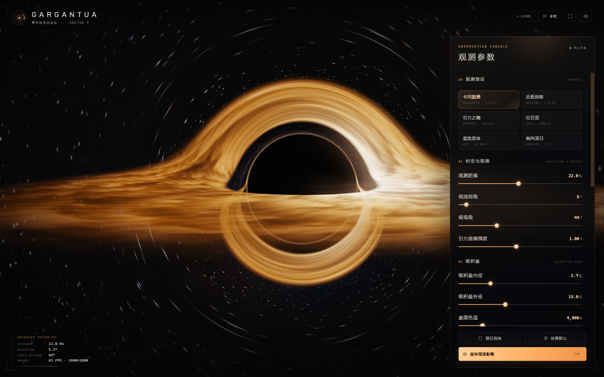

# GARGANTUA · 卡冈图雅黑洞观测台

一个纯前端、实时运行的交互式黑洞可视化网页。灵感来自电影《星际穿越》中的卡冈图雅：巨大的黑色阴影、炽热的吸积盘、被引力弯折成拱桥的盘面，以及被透镜效应拉成弧线的深空星场。

页面使用 **WebGL 2 + 自定义 GLSL 光线追踪** 实现，没有运行时第三方依赖；星场、吸积盘纹理和最终画面都在 GPU 上生成。



## 直接运行

双击打开 `index.html` 即可。页面脚本是经典脚本，不依赖 ES Module 加载，因此 `file://` 也能直接工作。

更推荐用一个本地静态服务器，以获得更稳定的缓存和调试体验：

```bash
cd gargantua
node tools/serve.mjs
# 打开 http://127.0.0.1:4173
```

也可以使用任意静态服务器（例如 `npx serve`、VS Code Live Server）。

## 操作方式

| 操作 | 功能 |
| --- | --- |
| 鼠标拖拽 / 单指拖动 | 环绕旋转视角 |
| 滚轮 / 双指捏合 | 拉近或拉远 |
| 双击画布 | 复位相机 |
| 右侧面板 | 调整时空、吸积盘、影像与后期参数 |
| 预设卡片 | 快速切换卡冈图雅、近距掠影、引力之瞳、红巨星、蓝类星体、侧向凌日 |
| `R` | 复位视角 |
| `P` | 展开 / 收起参数面板 |
| `H` | 隐藏 / 显示全部界面（也可点击右上角的“显示界面”） |
| `F` | 全屏 |
| `S` | 保存当前画面为 PNG |

## 参数说明

### 时空与观测

- **观测距离**：相机到黑洞的距离，单位为史瓦西半径 `Rs`。
- **视线仰角**：相机相对吸积盘赤道面的仰角，低角度更接近电影的经典构图。
- **视场角**：垂直视场角，类似镜头焦距。
- **引力透镜强度**：对测地线偏折项作艺术缩放，`1.00` 为史瓦西理论值。调低可看到更平直的星空，调高会得到更夸张的阴影与多重像。

### 吸积盘

- **内径 / 外径**：以 `Rs` 为单位的盘面范围。
- **盘面色温**：黑体色温，决定主色调；约 3000 K 为深橙红，约 4000 K 为标志性的琥珀金，约 11500 K 会偏冷白蓝。
- **盘面亮度 / 曝光**：两者共同控制高光滚降。
- **相对论多普勒**：开启后，朝向观察者运动的一侧会增亮、偏蓝；远离的一侧会变暗、偏红。
- **湍流细节**：盘面丝状流与热斑的对比度。
- **显示吸积盘**：关闭后只留下引力透镜星场，适合观察爱因斯坦环。

### 影像与后期

- **辉光**：HDR 高光溢出强度。
- **星空亮度 / 深空星云**：背景星场与银河尘埃的强度。
- **光子环增强**：在阴影临界环附近叠加一层柔和的电影化光晕。
- **时间流速**：吸积盘差动旋转和闪烁的速度。
- **渲染质量**：自适应模式会根据帧时间调整内部渲染分辨率；也可以固定为精细 / 均衡 / 流畅。

## 技术实现

### 1. 史瓦西零测地线

每条像素射线在通过相机和黑洞中心的轨道平面内，按 Binet 方程积分：

```text
d²u/dφ² + u = (3/2) · Rs · u²,   u = 1/r
```

使用 Velocity–Verlet 积分，步长由渲染质量控制。积分过程中检测射线穿过赤道面 `y = 0` 的位置，从而自然得到：

- 吸积盘在黑洞前方的近侧主像；
- 被引力弯折到黑洞上方与下方的次级像；
- 紧贴阴影边缘的高阶光子环；
- 盘面对背景星空的遮挡。

射线逃逸后，使用速度方向而不是有限半径处的位置方向计算星场采样方向；这一细节可以避免点状恒星被拉成不自然的径向条纹。

### 2. 吸积盘

吸积盘纹理在启动时由 GPU 生成（2048 × 1024，角度方向无缝），包含多层圆柱噪声、螺旋丝状流和热斑。运行时按半径做差动旋转：

```text
Ω ∝ (rIn / r)^1.5
```

盘面辐射使用近似黑体颜色、`T ∝ r^-3/4` 温度剖面，并叠加多普勒集束和引力红移。薄盘与光线的多次交点被前向合成，因此近侧盘面会遮挡远侧像，形成层次。

### 3. 星场

启动时程序化生成一张 1024² × 6 的星场 cubemap（约 2.9 万颗恒星及更暗的星尘）。相比每帧对每像素计算多层随机星点，纹理采样成本更低，也更容易在强透镜区域保持稳定。银河尘埃与星云则在着色器中用低频 3D 噪声叠加。

### 4. 后期与性能

- RGBA16F HDR 场景缓冲；
- 亮度阈值 + 两次可分离高斯模糊 bloom；
- 横向宽银幕式高光拖影；
- ACES 近似色调映射、暗角、细微色差、胶片颗粒与抖动；
- 自动质量：按平均帧时间在 0.5×–0.9× 内调整内部渲染比例，上限 400 万场景像素；
- 画布后备像素上限约 440 万，避免 4K / 高 DPI 下无意义的过度渲染；
- 屏幕坐标只应用一次宽高比修正，因此在任意窗口比例下黑洞阴影都保持为正圆，而不是被拉伸成椭圆。

在普通独显或较新的集成显卡上，1600 × 1000 分辨率通常可以保持 60 FPS 以上；移动端建议使用“流畅”或“自适应”质量。

## 开发

```bash
npm install
npm run build     # 将 src/ 打包为根目录的 app.js
npm run serve     # 本地服务器
```

源码结构：

```text
index.html          页面结构、侧边栏与加载界面
styles.css          电影化界面样式与响应式布局
src/main.js         相机、交互、状态、预设、自适应质量与启动流程
src/renderer.js     WebGL2 管线、HDR 目标、吸积盘纹理生成、后期
src/shaders.js      GLSL：测地线场景、盘纹理、bloom、合成
src/celestial.js    程序化星场 cubemap 生成
src/params.js       默认值、预设与控制项 schema
src/ui.js           控制面板构建、数值显示、键盘与面板交互
app.js              esbuild 打包后的可离线运行脚本
```

调试 API（浏览器控制台）：

```js
__GARGANTUA__.setParam('lensing', 1.4);
__GARGANTUA__.applyPreset('lens-only');
__GARGANTUA__.renderer.sceneTarget; // 当前场景 FBO 尺寸
__GARGANTUA__.fps;
```

## 说明

- 这是受电影美术启发的**实时可视化作品**。史瓦西度规的零测地线、引力红移与多普勒效应按物理规律近似求解；吸积盘的外观、光子环增强和部分镜头参数为电影化艺术处理，并非严格的辐射转移模拟。
- 页面不收集数据、不需要网络请求、没有追踪。
- 《星际穿越》及卡冈图雅相关名称与形象版权归其权利人所有，本项目仅作技术演示与视觉致敬。
