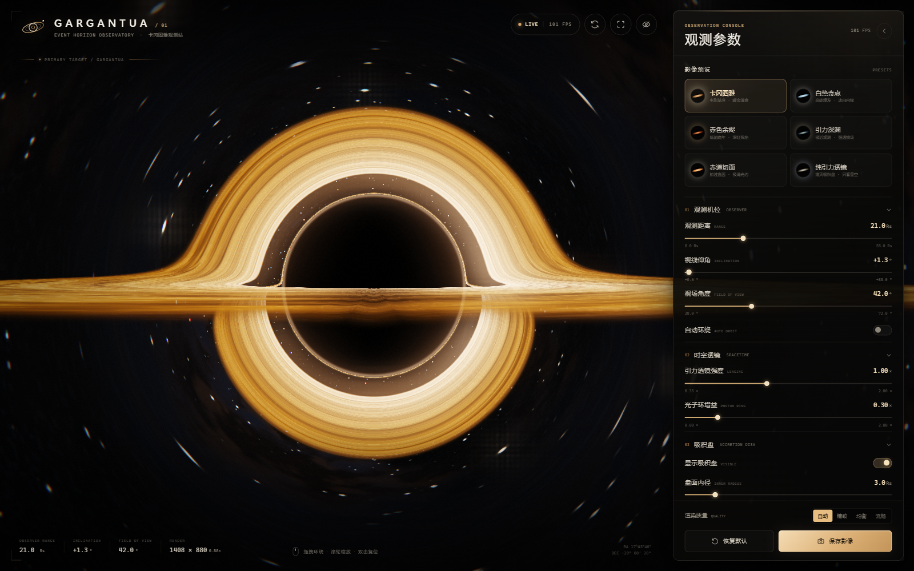

# GARGANTUA · 卡冈图雅黑洞观测台

一个受电影《星际穿越》（*Interstellar*）启发的实时黑洞可视化网页。画面中的暖金色吸积盘、漆黑的事件视界阴影、被引力弯折的上下光弧与背景星场，全部由 **WebGL2 + GLSL 实时光线追踪**生成。

项目不依赖任何运行时第三方库，也没有构建步骤：双击 `index.html`，或通过本地 HTTP 服务打开即可。



---

## 快速开始

### 方式一：直接打开

双击 `index.html`。页面使用经典脚本加载，因此 `file://` 直接打开也能正常工作。

### 方式二：本地 HTTP 服务

```bash
cd gargantua-horizon
node serve.mjs          # 打开 http://127.0.0.1:4173
```

也可以使用任意静态服务器，例如 `npx serve`、VS Code Live Server 等。

> 推荐使用 Chrome、Edge、Firefox 等支持 WebGL2 的现代浏览器，并开启硬件加速。

---

## 操作方式

| 操作 | 功能 |
| --- | --- |
| 鼠标拖动 / 单指拖动 | 环绕黑洞旋转观察 |
| 滚轮 / 双指捏合 | 拉近或拉远观测机位 |
| 双击画布 / `R` | 平滑复位观测机位 |
| 右侧参数面板 | 调整时空、吸积盘、星空与影像参数 |
| 预设卡片 | 快速切换卡冈图雅、白热奇点、赤色余烬、引力深渊、赤道切面、纯引力透镜 |
| 画布下方「保存影像」 | 导出当前无界面 HUD 的纯画面 PNG |
| `H` | 显示 / 隐藏全部界面，进入沉浸观测 |
| `P` | 收起 / 展开参数面板 |
| `F` | 全屏 |
| `S` | 保存影像 |
| `Space` | 开启 / 关闭自动环绕 |
| `Esc` | 退出沉浸模式或收起移动端面板 |

当「自动环绕」开启时，即使不触碰鼠标，视角也会缓慢绕黑洞巡航；拖动或缩放会即时覆盖自动运动。

---

## 参数说明

### 01 观测机位
- **观测距离**：相机到黑洞的固有距离，单位为史瓦西半径 `Rs`。
- **视线仰角**：相机相对吸积盘赤道面的仰角。靠近 0° 时呈现电影中标志性的极薄光刃与上下双重透镜拱。
- **视场角**：镜头垂直视场角。
- **自动环绕**：慢速自动巡航。

### 02 时空透镜
- **引力透镜强度**：缩放史瓦西测地线方程中的引力项。大于 `1.00×` 时会得到更强的弯曲、更宽的阴影和多阶盘像。
- **光子环增益**：增强临界光子轨道附近极细的高光边缘。

### 03 吸积盘
- **显示吸积盘**：关闭后只保留透镜化的星空与光子环。
- **盘面内径 / 外径**：以 `Rs` 为单位的吸积盘环带范围。
- **辐射色温**：近似黑体色温，从深红余烬（约 3000 K）到蓝白热斑（约 12000 K）。
- **盘面亮度 / 湍流细节 / 相对论多普勒 / 激流速度**：控制亮度、湍流的对比、多普勒增亮与色移，以及吸积流图案的转动速度。

### 04 星野与影像
- **星野密度 / 星野亮度 / 星际尘埃**：控制程序化生成的星场与银河尘埃。
- **曝光补偿 / 镜头泛光 / 暗角强度 / 胶片颗粒**：HDR 合成阶段的电影化调色参数。

底部的「渲染质量」提供 **自动 / 精致 / 均衡 / 流畅** 四档。自动档会依据帧率自动调整内部场景渲染分辨率，在画质与流畅度之间取得平衡。

---

## 技术实现

### 1. 史瓦西零测地线光线追踪

每个像素从观测相机出发，在黑洞所在的史瓦西时空中反向积分一条光线。单位取 `Rs = 1`，对轨道方程

```text
d²u/dφ² + u = (3/2) · Rs · u²,     u = 1/r
```

使用 **Velocity Verlet** 积分；越接近光子球，角步长越小。积分过程会检测光线与赤道面 `y = 0` 的每一次穿越，因此吸积盘的直接像、次级像和高阶像都由同一套测地线自然产生。

- 当光线落入事件视界，该方向保持为纯黑阴影。
- 当光线逃逸，使用渐近速度方向（而非逃逸半径处的有限位置）采样星空，避免远处恒星被拉成不自然的径向条纹。
- 临界冲击参数附近的亮环与主阴影共享同一套几何尺度。

### 2. 吸积盘

启动时由 GPU 生成一张 `2048 × 1024` 的极坐标湍流纹理：多层圆柱域 FBM、螺旋丝状结构、高频细纹与不透明度噪声，在角向严格无缝。运行时按开普勒差动角速度推进坐标采样：

```text
ω ∝ (r_in / r)^1.38
```

盘面颜色由径向温度剖面、引力红移、相对论多普勒因子和近似黑体色度共同决定；沿光线进行前向透明合成，因此近侧盘面会遮挡身后的高阶像。

### 3. 背景星场

- 启动时生成 1024² × 6 面的 HDR 星场立方体贴图，包含三层不同尺度的星点、恒星色温差异、少量带衍射十字的亮星与极暗未分辨星雾。
- 再生成一张 512² × 6 面的低频谱银河尘埃立方体贴图，包含斜跨天区的银河带与暗尘带。
- 两条纹理由引力透镜后的最终方向采样，因此星空也会随黑洞一起被放大、拖曳和弯折。

### 4. HDR 后处理

- `RGBA16F` HDR 场景缓冲（不支持浮点渲染目标时自动降级为 LDR）。
- 亮度阈值 → 两级可分离高斯泛光 → 宽银幕式横向光晕。
- ACES 近似色调映射、暖高光/冷阴影分离、轻微色散、暗角、胶片颗粒与抖动。

### 5. 性能策略

- 场景内部以自适应比例（0.5×–0.9×）渲染，再与高分辨率 UI 合成。
- 自动质量档依据滑动平均帧时间调整内部渲染分辨率。
- 星空、银河尘埃、吸积盘纹理均为一次性烘焙；逐帧只做测地线积分与后处理。
- 相机运动、角度阻尼和自动环绕与渲染解耦；标签页隐藏时自动暂停渲染。
- 在独立显卡或较新的集成显卡上，1600 × 1000 分辨率通常可稳定 60 FPS；移动设备或较旧的显卡建议选择「流畅」。

---

## 文件结构

```text
gargantua-horizon/
├── index.html          // 页面结构、HUD、面板、启动与错误界面
├── styles.css          // 电影化 HUD、控制台与响应式布局
├── preview.png         // 默认画面截图
├── serve.mjs           // 无依赖静态服务器
├── package.json
└── js/
    ├── shaders.js      // 星场 / 星云 / 吸积盘 / 测地线 / 泛光 / 合成 GLSL
    ├── params.js       // 参数模型、控制器 schema、6 个预设
    ├── gl.js           // WebGL2 编译、FBO、HDR 目标、cubemap 工具
    ├── renderer.js     // 渲染管线、纹理烘焙、自适应画质
    ├── ui.js           // 参数面板构建、读数、加载动画
    └── main.js         // 相机、指针交互、预设过渡、导出、启动流程
```

---

## 兼容性与说明

- 需要 WebGL2（着色器使用 `#version 300 es`）。
- 若扩展 `EXT_color_buffer_float` 不可用，会自动使用 8-bit 渲染目标；画面仍可工作，但泛光与高光层次会有所减弱。
- 本页面是受电影美术启发的**交互式可视化作品**，并非严格的天体物理模拟。测地线结构、引力红移与多普勒效应按史瓦西时空近似求解；吸积盘的色温、亮度、湍流与部分镜头参数经过电影化取舍。
- 不收集数据，不发起运行时网络请求。
- 《星际穿越》及卡冈图雅相关名称与形象的版权归其权利人所有；本项目仅用于技术演示与视觉致敬。

---

*“We used to look up at the sky and wonder at our place in the stars. Now we just look down, and worry about our place in the dirt.”*
