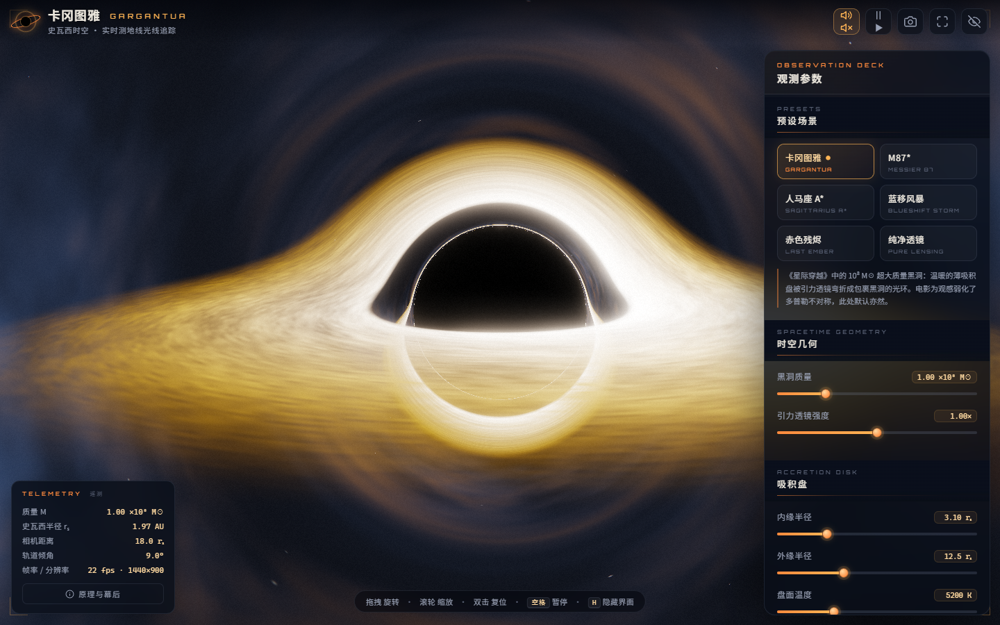

# 卡冈图雅 · GARGANTUA

在浏览器中实时重现电影《星际穿越》里的超大质量黑洞 **卡冈图雅**：
史瓦西时空零测地线光线追踪、开普勒差速吸积盘、引力透镜多重像、相对论多普勒束流与引力红移，全部在 GPU 片元着色器中逐像素求解。



## 运行

**直接双击 `index.html` 即可**（three.js 已本地化于 `vendor/`，完全离线可用，无需构建、无需服务器）。

也可以用任意静态服务器打开，例如：

```bash
python -m http.server 8080
# 浏览器访问 http://localhost:8080
```

推荐 Chrome / Edge / Firefox 最新版，需启用 WebGL（硬件加速）。
页面会自动检测 HDR 渲染能力并降级，集成显卡也能运行；帧率不足时自适应分辨率会自动介入。

## 操作

| 输入 | 作用 |
| --- | --- |
| 左键拖拽 / 单指滑动 | 环绕黑洞旋转（带阻尼惯性） |
| 滚轮 / 双指捏合 | 推拉相机距离 |
| 双击画布 | 复位视角 |
| `空格` | 暂停 / 继续吸积盘演化（相机仍可自由观察） |
| `H` | 隐藏全部界面，纯净观影 |
| `R` | 复位视角 |
| `S` | 导出当前画面为 PNG |
| `F` | 全屏 |
| `Esc` | 关闭弹窗 / 收起移动端面板 |

右侧「观测参数」面板提供 18 个实时滑块、画质档位、自适应分辨率与自动环绕开关，
以及 6 个预设场景：**卡冈图雅 / M87\* / 人马座 A\* / 蓝移风暴 / 赤色残烬 / 纯净透镜**。
左下角遥测面板实时显示质量、史瓦西半径（AU）、相机距离（rₛ）、轨道倾角、帧率与内部分辨率。

## 物理模型

- **引力透镜**：对每个像素数值积分史瓦西零测地线方程
  `d²u/dφ² + u = (3/2)·rₛ·u²`（直角坐标形式 `a = -3/2·rₛ·h²·r⃗/|r|⁵`），
  自适应步长在光子球 `1.5 rₛ` 附近加密。光线可多次穿越赤道面，
  自然产生吸积盘包裹黑洞上下方的标志性透镜像与光子环。
  「引力透镜强度」调至 0 可对比平直时空。
- **吸积盘**：薄盘温度谱 `T(r) ∝ r⁻³ᐟ⁴`，内缘默认取 ISCO `3 rₛ`；
  开普勒差速旋转 `ω ∝ r⁻³ᐟ²` 剪切出丝缕状湍流（角向无缝 fBm 噪声）；
  颜色由黑体辐射拟合实时映射。
- **相对论光度**：多普勒因子 `δ = 1/[γ(1−β·cosθ)]`，束流增亮 `∝ δ³` 并移动色温；
  引力红移 `g = √(1−rₛ/r)` 使内缘变暗偏红。电影为美学弱化了不对称，默认亦然；
  拉高「多普勒束流」即可得到 M87\* 照片式的真实形态。
- **背景**：三层方向空间哈希星场（无 UV 接缝、可闪烁）+ fBm 银河尘埃带，
  同样被透镜扭曲成弧与爱因斯坦环（试试「纯净透镜」预设）。

## 渲染管线

```
测地线光线追踪 (HDR HalfFloat)
  → 软阈值亮通提取
  → 三级降采样高斯泛光 (1/2 · 1/4 · 1/8)
  → 合成：泛光叠加 · 曝光 · 暗角 · 边缘色散 · ACES 调色 · 胶片颗粒
```

单 `requestAnimationFrame` 循环；几何、材质、渲染目标全部复用，逐帧零分配；
像素比封顶 2×，画质档位控制积分步数（96 / 144 / 208 / 288）与渲染分辨率；
自适应分辨率带迟滞防抖；截图在渲染完成后同帧读取，无需 `preserveDrawingBuffer`。

## 环境音

默认开启的深空低鸣（WebAudio 合成，无音频资源文件）：55 Hz 音簇 + 布朗噪声吸积流沙沙声，
滤波频率与呼吸节奏随「旋转速度」联动——声音始终对应画面上可见的运动。
顶栏扬声器按钮一键静音；受浏览器自动播放策略限制，首次点击页面后启动。

## URL 调试参数

| 参数 | 说明 |
| --- | --- |
| `?quality=low\|medium\|high\|ultra` | 画质档位 |
| `?scale=0.3..1` | 强制渲染分辨率比例（关闭自适应） |
| `?steps=N` | 覆盖测地线积分步数 |
| `?preset=gargantua\|m87\|sgrA\|blueShift\|ember\|pureLens` | 初始预设 |
| `?incl=角度&dist=距离&az=方位` | 初始相机 |
| `?t=秒` | 初始吸积相位 |
| `?paused=1` / `?rotate=0` / `?ui=0` | 暂停 / 关闭自动环绕 / 隐藏界面 |
| `?selftest=1` | 运行内置交互自检并输出报告 |

## 文件结构

```
index.html          页面骨架（顶栏 / 侧栏 / HUD / 弹窗 / 加载幕）
css/style.css       视觉系统：深空蓝黑 × 吸积盘琥珀
js/shaders.js       GLSL：测地线积分 · 吸积盘 · 星场 · 泛光 · 合成
js/engine.js        渲染引擎：HDR 管线 · 轨道相机 · 自适应分辨率
js/ui.js            参数系统 · 预设补间 · HUD · 环境音 · 快捷键
js/main.js          启动引导 · 错误兜底 · 运行时自检
vendor/three.min.js three.js r148（UMD，本地化，离线可用）
```

## 致谢与说明

视觉灵感来自《星际穿越》（2014）：基普·索恩提供广义相对论方程，
Double Negative 开发 DNGR 渲染器。本页面为史瓦西近似的艺术化实时演绎，
非科研级精度（未实现 Kerr 自旋参考系拖曳），但所有可调参数都对应真实的物理效应方向。