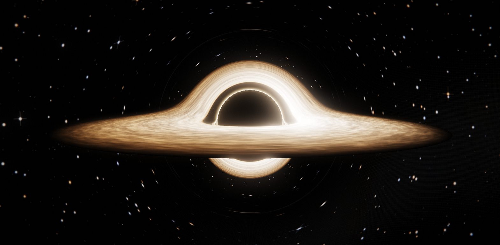
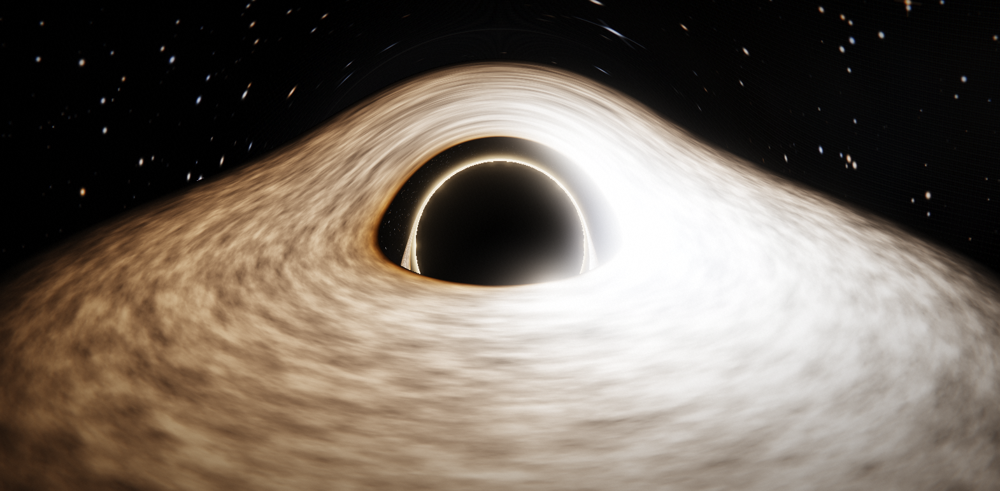

# GARGANTUA · 卡冈图雅 — 黑洞实时预览

一个模仿电影《星际穿越》中黑洞 **卡冈图雅（Gargantua）** 外观的实时图形化网页：
吸积盘、引力透镜、光子环、事件视界阴影与星空背景全部由物理驱动渲染，
支持鼠标旋转观察与侧边栏参数实时调节。



「物理真实」预设（全强度多普勒聚束 + 引力红移）：



## 运行方式

**零依赖、零构建**——纯 HTML/CSS/JavaScript + 原生 WebGL2，无需联网加载任何第三方库。

- 直接双击 `index.html` 用浏览器打开即可（Chrome / Edge / Firefox / Safari 15+）；
- 或在本目录启动任意静态服务器，例如：
  ```bash
  python -m http.server 8080
  # 浏览器访问 http://localhost:8080
  ```

> 需要浏览器支持 WebGL2 并开启硬件加速。集成显卡建议选「流畅」画质。

## 交互

| 操作 | 效果 |
| --- | --- |
| 鼠标拖拽 / 单指滑动 | 环绕黑洞旋转视角 |
| 滚轮 / 双指捏合 | 推拉距离（2.2 – 60 rₛ） |
| 双击画布 / `R` | 重置视角 |
| `空格` | 开关自动旋转 |
| `H` | 隐藏/显示全部界面（纯净观影模式） |
| `P` | 收起/展开参数面板 |
| 「保存截图」 | 导出当前画面 PNG |

URL 参数（可选）：`?quality=low|med|high`、`?preset=movie|physical|newton`、
`?ui=0`（隐藏界面）、`?still=1`（冻结时间与自转）。

## 侧边栏参数

- **观测**：视场角、自动旋转及速度、时间流速
- **吸积盘**：内/外半径（rₛ 单位）、峰值温度（黑体色）、亮度、盘晕厚度、湍流强度、物质旋速
- **相对论效应**：引力透镜强度（0 = 平直时空对比）、多普勒/红移调制
- **星空与后期**：星空亮度、泛光强度、曝光
- **性能**：流畅 / 均衡 / 极致（分辨率缩放 + 积分步数）

三个一键预设：

| 预设 | 说明 |
| --- | --- |
| **卡冈图雅** | 电影风格：暖白吸积盘、弱化多普勒不对称、薄盘光晕 |
| **物理真实** | 全强度多普勒聚束 + 引力红移：迎面侧明显更亮更蓝 |
| **牛顿视角** | 关闭引力透镜，直观对比光线弯曲带来的标志性光弧 |

## 技术实现

### 引力透镜（真实测地线，非贴图伪造）

每个像素发射一条光线，在史瓦西时空中按零测地线的 Binet 方程

```
u″ + u = (3/2)·rₛ·u²      (u = 1/r)
```

的等价三维中心力形式 `d²x/dλ² = −(3/2)·rₛ·h²·x/r⁵`（`h = |x×v|` 守恒）
做自适应步长 velocity-Verlet 积分。于是：

- **事件视界阴影**（r < rₛ 光线被捕获）、
- **光子球**（r = 1.5 rₛ）附近的无限绕转 → **光子环**、
- 吸积盘背面被弯折到黑洞**上方与下方**的光弧（卡冈图雅的标志性外观）、
- 背景星空的爱因斯坦环扭曲

全部自然涌现，无需任何手工绘制。

### 吸积盘

- Shakura–Sunyaev 零力矩内边界温度剖面 `T(r) ∝ [r⁻³(1−√(r_in/r))]^¼`，
  默认内缘位于最内稳定圆轨道 **ISCO = 3 rₛ**；
- 黑体辐射配色（Tanner Helland 拟合），内热外冷：白 → 黄 → 橙；
- 开普勒差速旋转 `Ω ∝ r^−3/2` 驱动的无缝 3D 湍流条纹；
- 相对论修正：局部轨道速度 `β = √(rₛ/2(r−rₛ))`，多普勒因子
  `δ = 1/γ(1−β·cosθ)`，引力红移 `√(1−rₛ/r)`；
  观测强度 ∝ g³、观测色温 ∝ g（g 为总频移因子），调制强度可调；
- 不透明薄盘 + 光学薄盘晕（厚度可调），边缘软化。

### 星空与后期

- 启动时程序化生成 4096×2048 等距柱状星图（球面均匀分布、幂律星等、
  色温配色、银河星云带与尘埃、亮星衍射十字、河外星系光斑），
  渲染时每像素仅一次纹理采样，性能开销极低；
- HDR（RGBA16F）渲染 → 软阈值亮度提取 → 5 级双滤波降采样 / tent 上采样泛光；
- ACES 色调映射、暗角、胶片颗粒、轻微径向色散。

### 性能

- 单全屏三角形 + 纯片元着色器光线追踪，无几何体、无第三方库；
- 自适应步长（∝ r）+ 提前终止（落入视界 / 逃逸 / 命中盘面）；
- 三档画质：分辨率缩放 0.55 / 0.8 / 1.0 × DPR，积分步数 120 / 190 / 300；
- 不支持浮点帧缓冲的设备自动回退 LDR 管线。

## 文件结构

```
index.html        页面骨架
css/style.css     影院级暗色 UI
js/gl.js          WebGL2 工具（着色器/渲染目标/全屏三角形）
js/shaders.js     全部 GLSL：测地线追踪、吸积盘、泛光、合成
js/stars.js       程序化星空贴图生成
js/camera.js      阻尼轨道相机（拖拽/滚轮/捏合/自转）
js/main.js        渲染管线、参数 UI、预设、截图
```

## 物理备注

本渲染器为**史瓦西（无自旋）黑洞**。电影中的卡冈图雅设定为近极端克尔黑洞，
其自旋会改变阴影形状与 ISCO 位置；这里以史瓦西几何再现其最核心的视觉特征
（透镜光弧 + 薄吸积盘 + 光子环），并按电影美学默认弱化多普勒不对称。